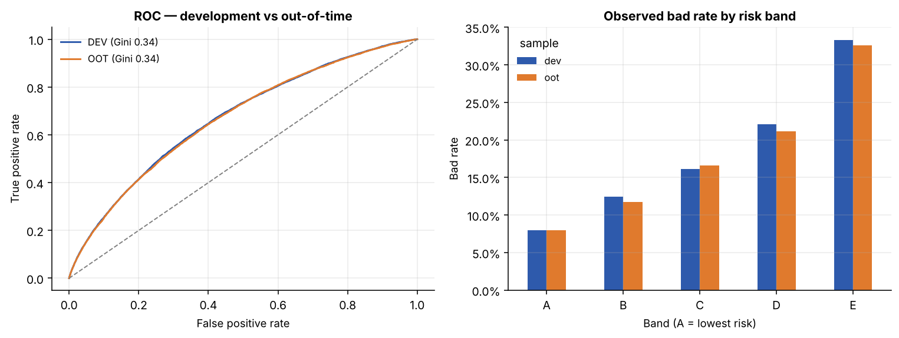
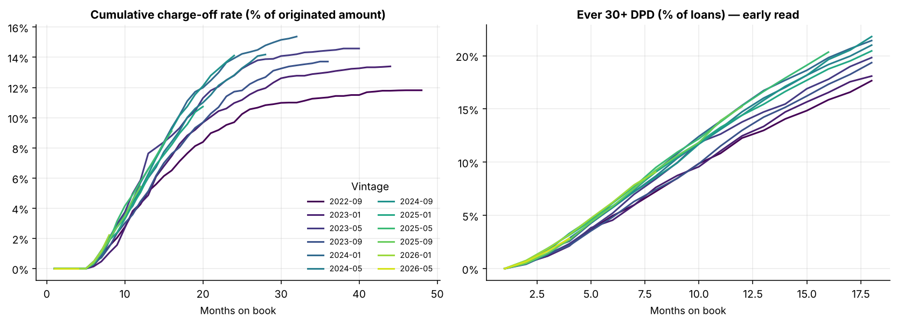
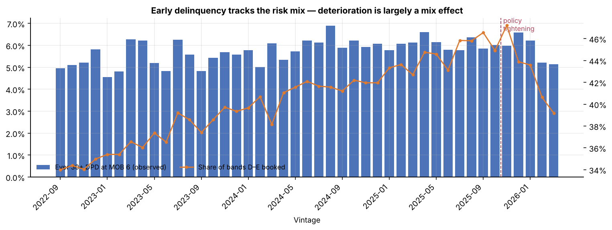
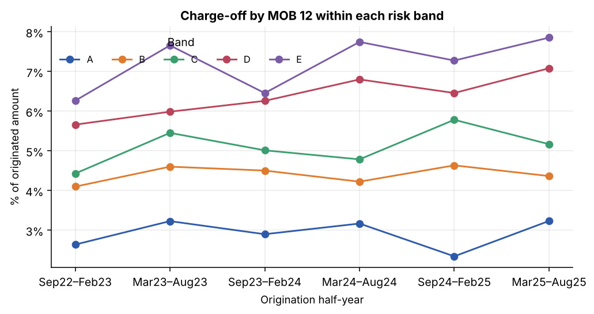
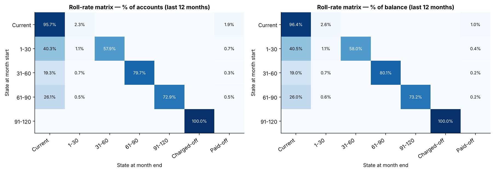
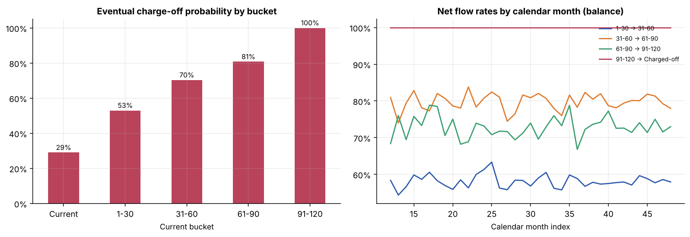
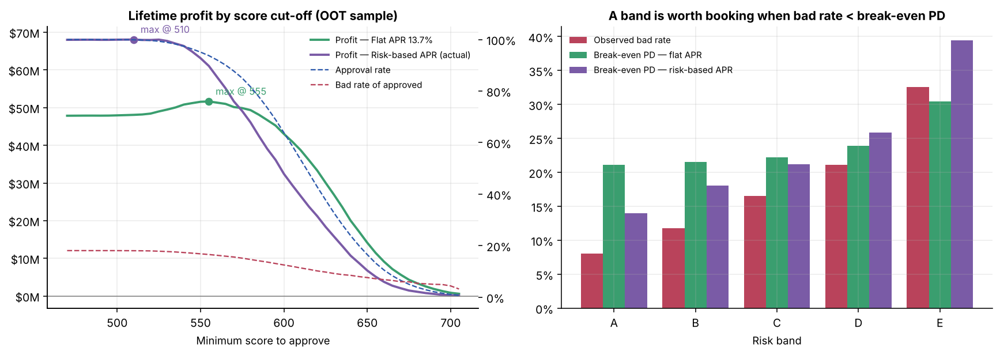
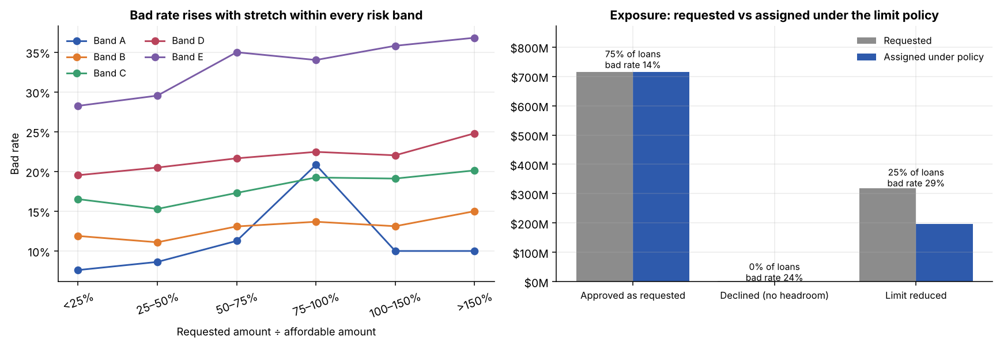
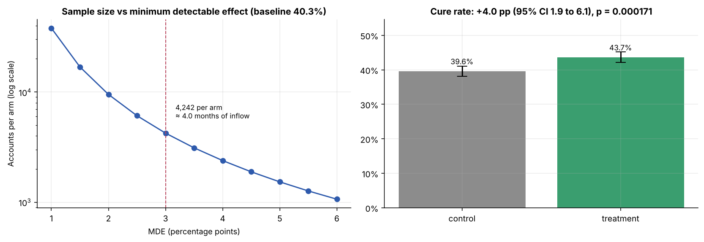
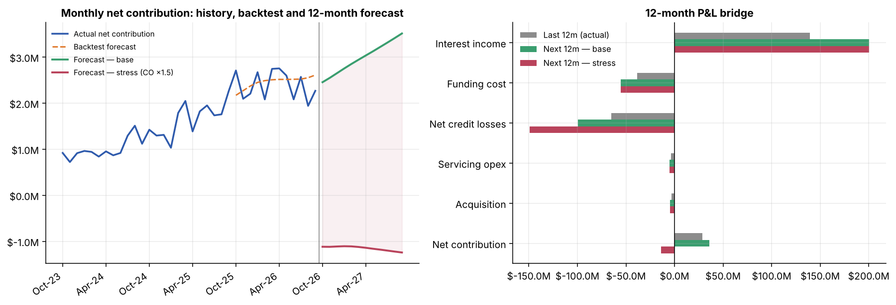

# Consumer Credit Decision Analytics — vintages, roll rates, cut-offs, limits, experiments & P&L

An end-to-end credit decision-science workflow on **164k real consumer loans**, built in **Python + SQL (DuckDB)**. It covers the six analyses a digital lender's credit team runs every month:

| # | Analysis | Question it answers | Script / SQL |
|---|---|---|---|
| 1 | **Application scorecard** | Who is likely to default? | `src/02_scorecard.py` |
| 2 | **Vintage curves** | Are newer cohorts worse, and is that mix or performance? | `sql/01_vintage_curves.sql`, `src/03_vintage_analysis.py` |
| 3 | **Roll-rate matrices & flow rates** | How does arrears move, and what is each bucket worth? | `sql/02…`, `sql/03…`, `src/04_roll_rates.py` |
| 4 | **Score cut-off with profit** | Where should we stop lending? | `sql/04_cutoff_strategy.sql`, `src/05_cutoff_profit.py` |
| 5 | **Credit limit & affordability rules** | How much should each approved customer get? | `src/06_limits_affordability.py` |
| 6 | **A/B test with power analysis** | Does an early-arrears nudge work, and how long must we test? | `src/07_ab_test.py` |
| 7 | **12-month P&L forecast** | What will the book earn next year, base and stressed? | `src/08_pnl_forecast.py` |

Everything runs with one command in ~30 seconds and every business assumption lives in [`src/config.py`](src/config.py).

```bash
pip install -r requirements.txt
python run_all.py        # downloads data, builds DuckDB, writes all figures & tables
pytest -q                # 11 sanity checks on the outputs
```

---

## Data — and an honest note on what is simulated

**Source:** the LendingClub consumer-loan extract published by H2O.ai ([`loan.csv`](https://github.com/h2oai/app-consumer-loan)): 163,987 unsecured personal loans with application data (amount, term, APR, income, DTI, revolving utilisation, credit history length, purpose, home ownership, income verification) and the **real final outcome** `bad_loan` (18.3% bad).

**What it lacks:** origination dates and month-by-month repayment history — both required for vintage and roll-rate work.

**What I did** (`src/01_ingest_and_simulate.py`):
1. **Assigned each loan to one of 48 monthly cohorts** (Sep-2022 → Aug-2026) with volume growing ~3%/month and a deliberate risk-mix story: the riskier half of applicants becomes progressively over-represented (a "growth push"), then a **policy tightening from Nov-2025** reverses it.
2. **Simulated a monthly delinquency path for every loan, anchored to its real outcome.** Bad loans walk `1-30 → 31-60 → 61-90 → 91-120 → Charged-off` from a first-missed-payment month skewed to the first 18 months on book; good loans can fall into transient arrears that cure, prepay, or run to maturity. Riskier loans miss payments more often. Balances follow each loan's actual amortisation schedule.
3. **Censored everything at a Sep-2026 snapshot**, so young vintages are only partly observed — like a live book.

So: **who defaults is real; when and how they travel through the arrears buckets is simulated.** Charge-off rates, the scorecard, cut-offs and limits rest on real outcomes; vintage shapes, roll rates and the P&L time series inherit the simulation's assumptions. The pipeline is written against generic `loans` / `performance` tables, so it runs unchanged on a real loan-tape.

Pricing in the source is US consumer lending (~13.7% average APR, USD). Unit economics are set for that context (`config.py`: 4% cost of funds, 75% LGD after recoveries, $3/month servicing, $50 acquisition) and can be swapped for a Naira book in one place.

---

## 1. Application scorecard

WoE-binned logistic regression, scaled to points (600 at 4:1 good:bad odds, 40 points to double the odds). Developed on cohorts before Jun-2025 and validated **out-of-time** on later ones.

| Sample | Loans | Bad rate | AUC | **Gini** | KS | PSI vs dev |
|---|---|---|---|---|---|---|
| Development | 84,794 | 18.5% | 0.670 | **0.341** | 0.250 | — |
| Out-of-time | 79,193 | 18.1% | 0.668 | **0.337** | 0.245 | 0.000 |

- **No decay out-of-time** and bad rates rank-order cleanly by band (OOT: A 8% → E 33%).
- **`int_rate` is deliberately excluded**: it is LendingClub's own risk-based price, so using it would just borrow their scorecard (Gini jumps, but you've learned nothing). `addr_state` is excluded on fairness/stability grounds.
- Gini ~0.34 is realistic for application data **without a bureau score** (the extract has no FICO). Strongest predictors by Information Value: term, DTI, revolving utilisation, income.



## 2. Vintage curves

Cumulative charge-off (% of originated amount) and ever-30+ DPD (% of loans) by months on book, each cohort shown only for the months it has actually been observed.



- Charge-offs at MOB 24 rise from **~10% for late-2022 cohorts to ~14% for early-2024 cohorts**.
- **Is that worse lending or worse borrowers?** Early delinquency rises and falls with the share of D–E bands booked, and charge-off at MOB 12 *within each band* is broadly flat across half-years → **the deterioration is predominantly mix, not performance**. The fix is the approval policy, not collections.
- The Nov-2025 tightening shows up first in **ever-30+ at MOB 6** (the early read) — the D–E share drops from 47% to 35% and early arrears follow, months before charge-offs can confirm it.




## 3. Roll-rate matrices & net flow rates

Transition matrices over the last 12 months (by account and by balance), then an **absorbing Markov chain** to turn them into "what is this bucket worth".



| Starting bucket | Eventual charge-off probability | Expected months to resolution |
|---|---|---|
| Current | 29% | 38 |
| 1-30 | **53%** | 27 |
| 31-60 | 70% | 18 |
| 61-90 | 81% | 12 |
| 91-120 | 100% | 1 |

- **Entering 1-30 nearly doubles an account's lifetime loss probability (29% → 53%)** — the biggest single jump, which is why early-bucket collections (and the A/B test below) carry the most value.
- Monthly entry into 1-30 rises from 1.5% (band A) to 3.4% (band E).
- **Net flow rates** (balance in bucket k ÷ balance in bucket k-1 last month) multiply to an implied **~0.9% of current balance charging off per month** — the standard collections loss-forecasting view.



## 4. Score cut-off with profit

Each loan's **lifetime profit** is built from its contractual cash flows: interest − funding cost − servicing − acquisition, and for bad loans interest only until the first missed payment minus LGD × balance at default. The cut-off is then swept on the out-of-time sample under **two pricing regimes**:

| Pricing | Strategy | Cut-off | Approval | Bad rate | Lifetime profit |
|---|---|---|---|---|---|
| **Flat APR 13.7%** | Approve all | — | 100% | 18.1% | $47.9M |
| | **Profit-maximising** | **555** | **94%** | **16.6%** | **$51.6M (+7.9%)** |
| | Risk appetite (bad ≤ 15%) | 580 | 82% | 14.6% | $49.3M |
| **Risk-based APR** (actual) | Approve all | — | 100% | 18.1% | $68.0M |
| | Profit-maximising | 510 | ~100% | 18.0% | $68.1M |



- **Under a single price**, band E's bad rate (33%) exceeds its break-even PD (30%), so the profit-maximising cut-off declines the worst ~6% and **adds $3.8M (+7.9%)**.
- **Under risk-based pricing**, every band's bad rate is below its break-even PD — price is already doing the cut-off's job, and cutting deeper only destroys profit.
- A tighter **risk-appetite** cut-off (bad ≤ 15%) costs $2.3M of profit vs the optimum in exchange for a lower, more stable loss rate. That gap is the price of risk appetite — a decision for the credit committee, not the model.
- **Caveat:** the data contains *booked* loans only, so "approval rate" is relative to an already-approved population. Moving a cut-off *below* today's would need reject inference.

## 5. Credit limit & affordability rules

```
assessed income   = monthly income × (1.0 if verified else 0.8)
headroom          = 40% × assessed income − existing debt service (DTI)
affordable amount = PV of headroom over the term at the loan's rate
limit             = min(requested, affordable × band multiplier [A 100% … E 40%], 35k cap)
```



- **Affordability adds information beyond the score.** Bad rate climbs from 12.7% (asking for <25% of what they can afford) to 30.1% (>150%), and in the top bucket runs **3.1 pp above score-predicted PD**. It rises with stretch within almost every band (band A's 75–100% bucket is small and noisy).
- **Portfolio impact (OOT):** 75% of loans unaffected, 25% get a lower limit (their bad rate is 29%), 0.4% declined for no headroom. **Exposure −12%, expected credit losses −20% ($114M → $92M).**
- Same lesson as the cut-off: with **flat pricing the policy adds $1.7M** of profit; with risk-based pricing it gives up $5.8M of loans that were priced to pay for their risk. Limits and price must be set together.
- Assumes default behaviour doesn't change with loan size — in practice smaller loans default less, so the benefit shown is conservative.

## 6. A/B test with power analysis — early-arrears nudge

**Hypothesis:** an in-app + SMS nudge on day 3 past due raises the share of 1-30 DPD accounts that cure by next month end.

**Pre-registered design:** unit = account entering 1-30; 50/50 split stratified by band; primary metric = cure rate; guardrail = roll to 31-60; α = 0.05 two-sided, 80% power, **MDE = +3 pp**; fixed horizon, no peeking.



| | |
|---|---|
| Baseline cure rate | 40.3% |
| **Required sample** | **4,242 per arm ≈ 4 months** of 1-30 inflow (~2,125/month) |
| Sample-ratio mismatch check | p = 0.97 ✓ |
| Result | 39.6% → 43.7%: **+4.0 pp (95% CI 1.9 to 6.1), p = 0.0002** |
| Guardrail (roll to 31-60) | 58.8% → 55.0% ✓ |
| Value | each extra cure avoids ~$1,990 of expected loss → **~$2.0M/year** |

- The experiment uses **real 1-30 accounts**; control keeps its real outcome and a **known +3.5 pp effect** is injected into treatment, so the analysis can be checked against the truth — the CI covers it.
- The power curve is the planning conversation: halving the MDE to 1.5 pp needs **16k per arm (~16 months)** — usually not worth it.
- **Subgroup trap, demonstrated:** the injected effect is identical in every band, yet band-level uplifts range from +2 to +6 pp and one passes Bonferroni. Subgroup cuts are exploratory, never the headline.

## 7. 12-month P&L forecast

A **cohort / vintage-curve engine**: per-MOB curves (balance, interest, charge-offs, active accounts as a share of originated amount) learned by term, risk-adjusted per cohort by average PD, rolled forward over the existing book plus originations forecast with damped Holt exponential smoothing.

**Backtested first:** learning only on data to Sep-2025 and forecasting the following 12 months, net contribution came in **+2.7%** vs actual, but credit losses were **under-forecast by 8.5%** (the score only partly sees the riskier growth-push mix). That bias is applied as an explicit, documented **calibration overlay** (losses × 1.09, interest × 1.04) on the forward view.



| $M | Last 12m actual | Next 12m base | Next 12m stress (losses ×1.5) |
|---|---|---|---|
| Interest income | 139.2 | 200.4 | 200.4 |
| Funding cost | (38.4) | (55.3) | (55.3) |
| Net credit losses | (65.2) | (99.3) | (149.0) |
| Servicing + acquisition | (6.8) | (9.9) | (9.9) |
| **Net contribution** | **28.7** | **35.8** | **(13.8)** |
| % of average balance | 3.0% | 2.6% | −1.0% |

- Profit grows with the book (+44% average balance), but **margin compresses from 3.0% to 2.6%** as the riskier 2024–25 cohorts reach peak charge-off months.
- A 1.5× loss stress turns the year **loss-making** — the case for keeping the Nov-2025 tightening in place.
- **Not modelled:** IFRS 9 provisioning. A bank P&L books expected-loss impairment ahead of charge-off; this forecast recognises losses at charge-off, closer to a cash view.

---

## Repository layout

```
├── run_all.py                    # one-command pipeline
├── requirements.txt
├── sql/                          # DuckDB SQL (ANSI-style; ports to Postgres/BigQuery)
│   ├── 01_vintage_curves.sql
│   ├── 02_roll_rate_matrix.sql
│   ├── 03_bucket_balances.sql
│   └── 04_cutoff_strategy.sql
├── src/
│   ├── config.py                 # paths + every business assumption
│   ├── 01_ingest_and_simulate.py # download, clean, cohorts, monthly performance → DuckDB
│   ├── 02_scorecard.py           # WoE logistic scorecard, OOT validation
│   ├── 03_vintage_analysis.py
│   ├── 04_roll_rates.py          # matrices, absorbing Markov chain, flow rates
│   ├── 05_cutoff_profit.py
│   ├── 06_limits_affordability.py
│   ├── 07_ab_test.py
│   ├── 08_pnl_forecast.py
│   ├── economics.py              # loan-level lifetime profit (shared)
│   ├── db.py, plotting.py
├── tests/test_pipeline.py        # data integrity + analytical sanity checks
└── outputs/
    ├── figures/                  # all charts
    └── tables/                   # every number in this README, as CSV
```

**Database tables:** `loans` (application data + cohort), `performance` (one row per loan-month: state at start/end, balances, interest, charge-off), `scores` (PD, score, band, dev/OOT), `loan_profit` (lifetime profit under each pricing regime), `meta`.

## Limitations & next steps

- Replace the simulated monthly history with a real loan tape — no code changes needed beyond `01_ingest`.
- Add a bureau score and behavioural features; segment scorecards by product/term.
- Reject inference before relaxing any cut-off.
- IFRS 9 staging and ECL so the P&L shows impairment, not just charge-offs.
- Joint optimisation of price × limit × cut-off rather than one lever at a time.
